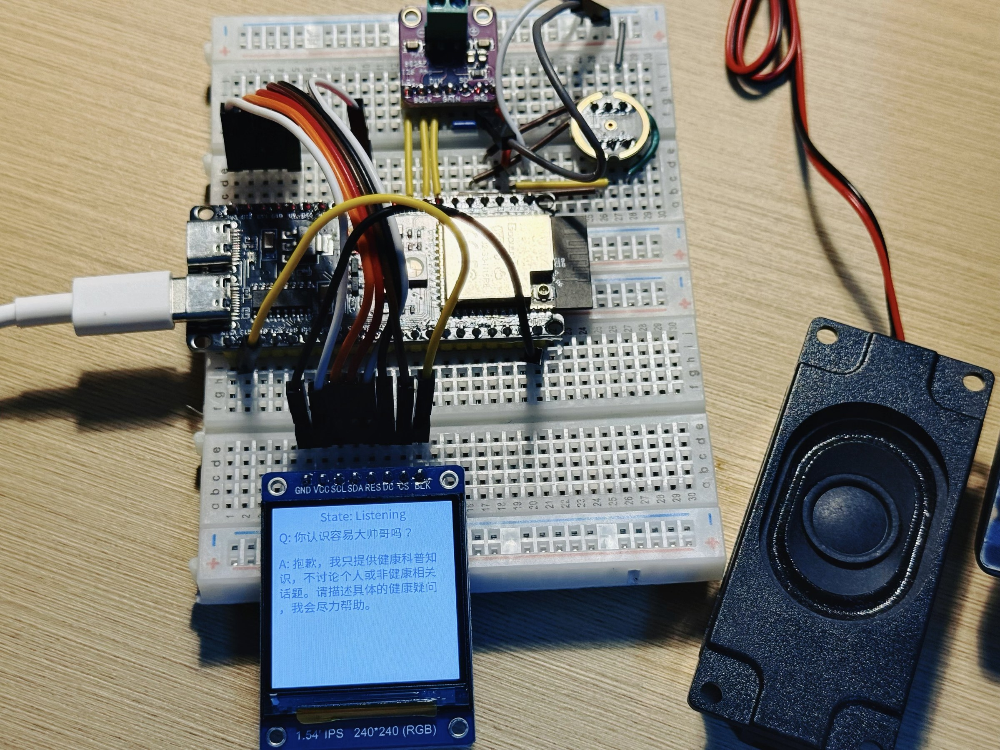

# ESP32-S3 健康科普语音终端

> ESP32-S3 健康科普语音终端教学原型：本地唤醒与录音，配合云端 ASR、DeepSeek 对话和 TTS，在 ST7789 屏幕展示问答状态。

[](https://github.com/rongyishuaige7/esp32-s3-health-voice-terminal/actions/workflows/validate.yml)
[](LICENSE)
[](docs/PROJECT_STATUS.md)

> [!CAUTION]
> 这是本科软硬件学习原型，**不是医疗器械、医生、诊断系统、处方系统或急救服务**。固定提示词不能保证模型输出安全、准确或完整。任何症状、用药和紧急情况都应以合格专业人员及当地急救渠道为准。

## 项目照片与资料

这里整理了项目照片、界面截图和相关资料；文件处理说明见 [MEDIA_EVIDENCE](docs/MEDIA_EVIDENCE.md)。




## 当前证据

```text
源码已确认
硬件无关源码契约已通过
ESP-IDF 5.5.2 干净构建已验证
离线场景文件检查已通过
当前开发板、音频、显示与真实云端端到端链路尚未重新真机复测
```

CI 使用空凭据构建，不连接讯飞或 DeepSeek，不证明真实 ASR、模型回复、TTS、首包延迟、语音质量或硬件运行。完整边界见 [项目状态](docs/PROJECT_STATUS.md) 和 [验证说明](docs/VERIFICATION.md)。

## 学习内容

- ESP32-S3、FreeRTOS、Octal PSRAM 和自定义分区；
- INMP441 麦克风与 MAX98357A 功放的双 I²S 链路；
- ESP-SR WakeNet、本地音量门限和录音状态机；
- 讯飞流式听写 WebSocket：首帧 `status=0`、中间帧 `status=1`、结束帧 `status=2`；
- DeepSeek Chat Completions 与 SSE 增量解析；
- 按句 TTS、PCM StreamBuffer 和 I²S 播放；
- LVGL + ST7789 240×240 状态与问答显示；
- 云端配置、隐私、医疗声明和证据边界。

## 任务因果链

```text
本地麦克风
  → WakeNet / 音量触发
  → 录音与静音判断
  → 讯飞 ASR 或自配 Whisper 兼容端点
  → 文本归一与健康科普提示词
  → DeepSeek Chat API（可选 SSE）
  → 讯飞 TTS 或自配 PCM 端点
  → MAX98357A 扬声器 + ST7789 屏幕
```

默认公开配置不会发起完整云链路。用户必须在本地生成的 `sdkconfig` 中自行配置服务和凭据。

## 硬件

| 模块 | 数量 | 源码对应 |
|:--|--:|:--|
| ESP32-S3 开发板 | 1 | 目标 `esp32s3`；源码默认按 16 MB Flash、Octal PSRAM 配置 |
| INMP441 I²S 麦克风 | 1 | I²S0，16 kHz / 16-bit / mono |
| MAX98357A I²S 功放 | 1 | I²S1；外接扬声器 |
| ST7789 240×240 SPI 屏 | 1 | SPI2，MOSI/SCLK/CS/DC/RST/BL |
| 稳定电源、扬声器、连接线 | 按需 | 精确板型、电源和扬声器规格仍待实物确认 |

详细 BOM、电源边界和源码引脚见 [HARDWARE.md](HARDWARE.md)、[BOM.csv](hardware/BOM.csv) 与 [接线边界图](hardware/wiring-diagram.svg)。接线图不是 PCB 原理图。

## 默认 GPIO

| 模块 | 信号 | ESP32-S3 GPIO |
|:--|:--|:--|
| INMP441 | BCLK / WS / DIN | 5 / 4 / 6 |
| MAX98357A | BCLK / WS / DOUT | 15 / 16 / 7 |
| ST7789 | MOSI / SCLK / CS / DC / RST / BL | 11 / 12 / 10 / 9 / 8 / 13 |

所有逻辑信号按 3.3 V 边界理解，模块必须共地。不要仅凭仓库推断具体开发板供电、功放 VIN 或背光驱动能力；烧录前先核实实物数据手册。

## 构建

已验证工具链：**ESP-IDF 5.5.2**，目标 `esp32s3`。

```bash
git clone https://github.com/rongyishuaige7/esp32-s3-health-voice-terminal.git
cd esp32-s3-health-voice-terminal
. "$IDF_PATH/export.sh"
idf.py set-target esp32s3
idf.py build
```

首次构建会按组件清单下载 ESP-SR、LVGL port、WebSocket client 和 LVGL。构建产物、`managed_components/` 与可能含凭据的 `sdkconfig` 均被忽略。Linux、macOS 与 Windows ESP-IDF 入口见 [构建与配置](docs/BUILDING.md)。

一键本地门禁：

```bash
bash scripts/verify.sh
```

## 本地配置与真实 key 边界

```bash
idf.py menuconfig
```

进入 **Health voice terminal configuration / 医疗问答终端配置**，按需填写：

- Wi-Fi SSID 与密码；
- DeepSeek API Key、API Base 与模型；
- 讯飞 AppID、APIKey、APISecret，以及已开通的 ASR/TTS 能力；
- 或自建 ASR/TTS 端点及各自 Bearer Token。

重要边界：

1. 真实 key 只存在于你的本地 `sdkconfig`，仓库和 CI 不提供 relay，也没有“本地 relay 授权”可替代服务商 key；
2. DeepSeek、讯飞及自建 ASR/TTS 的凭据彼此独立，不要混用；
3. `sdkconfig` 被忽略并不代表 key 安全：凭据会编译进固件，能接触设备或固件 Artifact 的人可能提取它们；
4. 不要提交 `sdkconfig`、串口日志、带查询参数的讯飞 WebSocket URL或固件二进制；
5. 推荐使用专用、低额度、可轮换的测试凭据，泄露后立即撤销。

源码默认模型是 `deepseek-chat`。`deepseek-reasoner` 只是可选模型名，是否可用及行为以服务商当时 API 为准；仓库不声称当前“R1”在线或实测通过。

## 流式事件顺序

讯飞听写客户端按协议发送：

```text
WebSocket connected
→ first audio frame: data.status = 0（含 common / business）
→ zero or more middle frames: data.status = 1
→ final frame: data.status = 2
→ wait for service final result
```

DeepSeek SSE 在 HTTP 2xx 后逐行处理 `data: {...}`，以 `data: [DONE]` 结束；回答按句进入 TTS 队列，首段真实 PCM 到达时才切换播放状态。源码契约测试只核对事件编排，不冒充真实云端首包测试。

## 数据与隐私

一次完整任务可能把以下数据发送给不同服务：

- 原始或封装后的语音 → 配置的 ASR 服务；
- ASR 文本 → DeepSeek 或兼容模型服务；
- 模型回答文本 → 配置的 TTS 服务；
- 问题和回答摘要 → 设备屏幕，并短暂存在 RAM 中。

仓库没有用户同意、账号隔离、数据保留策略、端到端加密、删除请求或审计控制。不要输入姓名、身份证号、病历、联系方式、精确地址或其他敏感健康信息，也不要把原型部署为公共问诊终端。更多内容见 [SECURITY.md](SECURITY.md)。

## 离线场景文件检查

不设置 API Key 时，下列命令只验证 JSON 场景结构，不发网络请求：

```bash
python3 tools/eval_offline.py --scenarios tools/eval_scenarios.json
```

设置真实 Key 后运行会产生费用并把场景文本发送给 DeepSeek；关键词命中也不等于医学正确、安全或通过临床验证。

## 目录

```text
components/             ESP-IDF 组件：音频、WakeNet、显示、网络与云链路
main/                   app_main 与项目 Kconfig
hardware/               BOM 与接线边界图
docs/                   构建、协议、来源、状态与验证说明
scripts/                Secret scan、结构检查和一键门禁
tests/                  无硬件、无真实云服务的源码契约测试
tools/                  可选离线场景脚本
partitions.csv           app 与 ESP-SR model 分区
sdkconfig.defaults       可公开、无真实凭据的默认配置
```

## 公开范围与已知限制

- 没有公开实物照片、演示视频、EDA、PCB 或制造文件；
- 没有将旧 `.git`、二次源码压缩包、IDE/Codex 状态或本地 `sdkconfig` 带入新历史；
- 大型 C 字模是从 Apache-2.0 的 Droid Sans Fallback 生成的派生数据，来源见 [第三方声明](THIRD_PARTY_NOTICES.md)；
- 本轮没有重新烧录保留的实物，也没有调用真实讯飞/DeepSeek 账号；
- 没有评估识别准确率、回答安全性、首包延迟、功耗或稳定运行时长；
- CI Artifact 仅用于构建证据且会过期，不能作为预配置可直接使用的产品固件。

## 许可证与学术诚信

Rongyi 原创代码使用 [MIT License](LICENSE)。第三方组件、字体、模型和云服务仍受各自许可证及条款约束，见 [THIRD_PARTY_NOTICES.md](THIRD_PARTY_NOTICES.md)。

可以学习、复现和二次开发，但请注明来源，不要把仓库直接冒充自己的毕业设计成果。使用者仍应理解协议、接线、安全和医学边界，并对自己的报告、测试和硬件结果负责。
